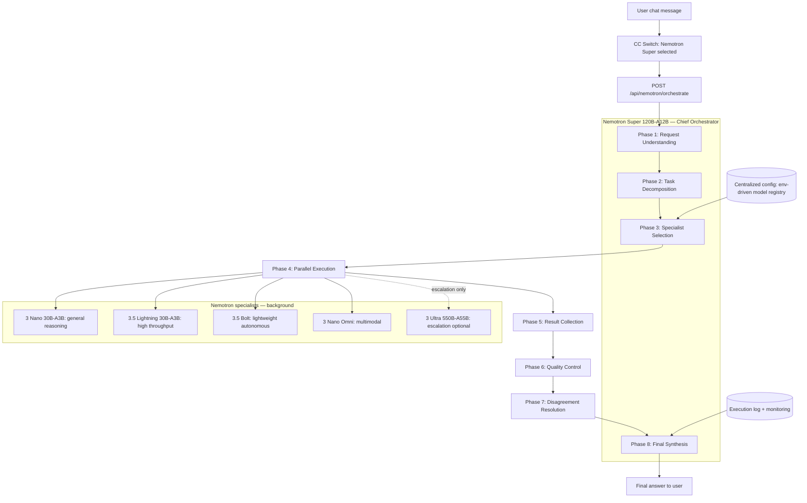

# Nemotron Multi-Agent Orchestration — Architecture

## Model hierarchy

| Level | Model | Role |
|---|---|---|
| 1 | Nemotron 3 Super 120B-A12B | Chief Orchestrator (Super) |
| 2-A | Nemotron 3 Nano 30B-A3B | General reasoning |
| 2-B | Nemotron 3.5 Lightning 30B-A3B | High-throughput |
| 2-C | Nemotron 3.5 Bolt | Lightweight autonomous |
| 2-D | Nemotron 3 Nano Omni | Multimodal |
| 2-E | Nemotron 3 Ultra 550B-A55B | Advanced reasoning / optional escalation |

## Execution phases (Super-controlled)

1. **Request understanding** — classify category, estimate complexity
2. **Task decomposition** — break into subtasks with objectives, expertise, dependencies
3. **Specialist selection** — pick Nemotron models per routing policy; Super can override
4. **Parallel execution** — concurrent subtasks with concurrency limits, timeouts, retries
5. **Result collection** — per-task records (model, response, duration, tokens, status)
6. **Quality control** — Super verifies accuracy, completeness, consistency, relevance
7. **Disagreement resolution** — reconsider → independent assessment → Ultra escalation → Super decides (no majority vote only)
8. **Final synthesis** — Super combines, deduplicates, discloses uncertainty

## Key constraints (non-negotiable)

- Only Nemotron models act as AI agents — no DeepSeek, Claude, GPT, Qwen, GLM fallbacks
- Super controls all delegation; no recursive agent chains from specialists
- Ultra is optional escalation only
- No non-Nemotron fallback; report inability to delegate if none available
- Centralized config, env-based credentials, per-model enable/disable
- Execution log tracks every step for user inspection
